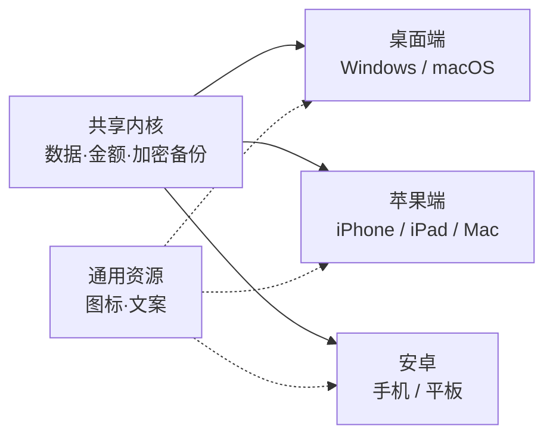

# SnowFold

**完全离线、本地优先的个人资产与订阅管理工具。**

SnowFold 专为重视隐私与数据掌控权的用户设计：无需注册账号，应用运行时**零网络请求**，首次启动即为一个干净的本地账本。所有数据仅保存在本机 SQLite 数据库中；当你需要云端备份或跨设备换机时，可通过 AES-256-GCM 加密备份安全流转。

---

## 核心功能

- **全局总览看板**
  实时计算总资产、总负债与净资产，直观展示各分类占比，并提醒近期即将扣款的订阅项。
- **资产与负债台账**
  涵盖五个固定资产/负债分类，支持名称与余额行内快速编辑、记录余额变动快照、修正历史记录，并提供删除后 6 秒内撤销保护。
- **多币种订阅管理**
  支持 `CNY` / `USD` 计价与周、月、季、年四种周期；自动处理逾期多期续费日期推算，支持随时暂停与恢复，并按分组和币种统计周期开销。
- **安全备份与无损换机**
  支持全量 JSON 导入导出与 **`.sfseal` 加密备份**。每次导入均在校验通过并二次确认后，于数据库事务内原子替换，杜绝数据半途损坏。

---

## 支持平台

四端共享同一套 Rust 数据核心，业务规则、统计口径与备份格式在所有设备上完全一致，界面则采用各平台原生框架构建：



<!-- platform-status: 由集成时按验收结果更新 -->

| 平台 | 原生界面框架 | 布局适配 | 当前状态 |
| --- | --- | --- | --- |
| **Windows 桌面** | GPUI | 桌面宽屏布局（支持全键盘快捷键） | 功能完整，主要桌面目标 |
| **iOS / iPadOS** | SwiftUI | iPhone 窄屏布局 / iPad 分栏布局 | 功能完整 |
| **macOS** | SwiftUI | 原生侧边栏布局 | 功能完整 |
| **Android** | Jetpack Compose | 手机窄屏布局 / 平板列表-详情分栏布局 | 功能完整 |

---

## 快速上手与数据管理

### 1. 数据存在哪里？

SnowFold 的所有账本数据均存放在本机目录中（可在应用「设置」页随时查看实际路径）：

| 平台版本 | 默认数据目录 |
| --- | --- |
| **Windows（GPUI）** | `%LOCALAPPDATA%\SnowFold\data\`（`snowfold.sqlite3`） |
| **macOS（SwiftUI）** | `~/Library/Containers/app.snowfold/Data/Library/Application Support/SnowFold/` |
| **iPhone / iPad** | 应用沙盒 `Application Support/SnowFold/` |
| **Android** | 应用私有目录 `filesDir` |

### 2. 如何备份与换机？

SnowFold 提供三种数据保护方式，适应不同场景：

1. **防误删自动备份（桌面端）**：GPUI 桌面端每次启动时会在数据目录 `backups/` 下自动保留最近 10 份明文 JSON 快照，方便日常误操作恢复。
2. **明文备份（本机迁移）**：在「设置 → 导出备份」中生成 `.json` 文件，适合在受信任的本地存储介质间直接恢复。
3. **加密备份（网盘与跨设备换机）**：
   - **日常上云**：在「设置 → 导出密文」中生成 `.sfseal` 加密密封包，可放心上传至网盘或通过聊天工具发送。
   - **换机 / 重装恢复**：
     1. 在旧设备「设置」中点击 **导出恢复码**（离线妥善保存）并 **导出密文（`.sfseal`）**；
     2. 在新设备「设置」中先 **导入恢复码**（核对密钥指纹一致）；
     3. 再 **导入加密备份**，确认导出时间与记录数量无误后即可完整恢复。

> [!IMPORTANT]
> **数据安全须知**
> - **切勿直接同步数据目录**：数据目录中的数据库与启动自动备份均为明文，请勿将该目录放入 iCloud、OneDrive 等云盘同步目录。需要上云请务必使用「导出密文（`.sfseal`）」。
> - **妥善保管恢复码**：加密备份采用 256 位随机密钥（非口令派生）。一旦本机密钥与离线恢复码同时丢失，已导出的加密备份将**永久无法解密**。详见 [安全与加密设计](SECURITY.md)。

### 3. 桌面端快捷键（GPUI）

| 功能 | 快捷键 |
| --- | --- |
| 切换「总览 / 资产 / 订阅」 | `Cmd/Ctrl + 1` / `2` / `3` |
| 在当前页面新建记录 | `Cmd/Ctrl + N` |
| 打开设置 | `Cmd/Ctrl + ,` |
| 确认输入 / 激活焦点控件 | `Enter`（或 `Space`） |
| 关闭编辑状态、浮层或设置 | `Esc` |
| 焦点导航 | `Tab` / `Shift + Tab` |
| 退出应用 | `Cmd/Ctrl + Q` |

更多功能细节与恢复流程说明，请参阅 [完整使用说明](docs/usage.md)。

---

## 从源码构建

构建需要安装 **Rust 1.96.0**。仅首次编译拉取依赖时需要网络，编译产物运行时无需联网。

### 各平台快速构建

- **Windows 桌面端**（Windows 宿主，在仓库根目录打开 Developer PowerShell）：
  ```powershell
  powershell -NoProfile -ExecutionPolicy Bypass -File .\apps\desktop\packaging\windows\package.ps1
  ```
- **iOS / iPadOS / macOS 端**（macOS 宿主，仓库根目录）：
  ```sh
  ./apps/apple/scripts/build-core.sh
  # 随后使用 Xcode 打开 apps/apple/SnowFold.xcodeproj 运行或归档
  ```
- **Android 端**（macOS / Linux / Windows 宿主，进入 `apps/android/` 目录）：
  ```sh
  ./gradlew assembleDebug
  ```

### 核心与工作区检查

```sh
cargo fmt --check
cargo check --locked --workspace
cargo test --locked --workspace
```

完整的编译环境配置、FFI 绑定生成、签名与安装包制作流程，请参阅 [构建与开发指南](docs/development.md)。

---

## 仓库结构与文档导航

```text
.
├── core/       # 四端共用的 Rust 数据核心（领域模型、SQLite 存储、AES-256-GCM 加密备份、FFI 接口）
├── apps/       # 各端原生宿主工程：desktop (GPUI)、apple (SwiftUI)、android (Compose)
├── shared/     # 跨端共用资源（应用图标与界面矢量 SVG）
└── docs/       # 使用说明、设计规范与架构文档
```

### 延伸阅读

| 类别 | 文档 | 说明 |
| --- | --- | --- |
| **用户指南** | [docs/usage.md](docs/usage.md) | 数据目录、快捷键、明文/加密备份、换机恢复详细步骤 |
| **安全设计** | [SECURITY.md](SECURITY.md) | 加密备份威胁模型、信封格式、密钥与恢复码机制 |
| **产品与视觉** | [docs/design.md](docs/design.md) | 桌面端视觉规范与交互设计基准 |
| | [docs/mobile-layout.md](docs/mobile-layout.md) | iOS / iPadOS / Android 窄屏与分栏布局规范 |
| | [docs/copy.md](docs/copy.md) | 四端统一的中文界面文案契约 |
| | [docs/icons.md](docs/icons.md) | 图标矢量源文件与各端资源生成链 |
| **架构与开发** | [docs/architecture.md](docs/architecture.md) | 仓库分层原则、目录规则、源码与生成产物边界 |
| | [docs/core-api.md](docs/core-api.md) | 共享核心接口契约、错误语义与备份版本兼容规则 |
| | [docs/development.md](docs/development.md) | 各端环境准备、构建、打包、CI 覆盖与验收流程 |
